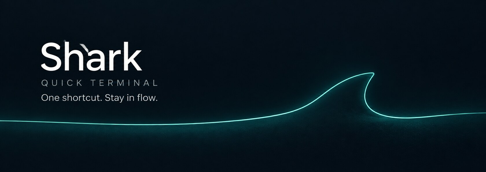

<p align="center">
  
</p>

<p align="center">
  <strong>A quick terminal for macOS. Less switching. More flow.</strong><br>
  Your terminal comes to you, so you can stay with the thought.
</p>

<p align="center">
  <a href="https://github.com/o98k-ok/shark/releases/latest"><strong>Download for Mac</strong></a>
  &nbsp; · &nbsp;
  <a href="#stay-with-the-thought">Why Shark</a>
  &nbsp; · &nbsp;
  <a href="#keys-you-can-keep-in-your-hands">Shortcuts</a>
  &nbsp; · &nbsp;
  <a href="#build-from-source">Build from source</a>
</p>

<p align="center">
  
  
  
</p>

## Stay with the thought

You're reading code. You need to check a branch, run a command, or watch a log.
That should be a small detour, not a search through terminal windows.

Press <kbd>⌃</kbd> + <kbd>`</kbd>. Shark drops down over your current workspace,
ready to type. Run what you need, then click back into your work.
The panel disappears. Your shell keeps running.

**Next time you call it, you're right where you left off.**

| Call it | Use it | Get back to it |
|:---|:---|:---|
| One global shortcut, without hunting for a window. | A real terminal, with your shell and its login profile. | Hide the panel without losing running commands or scrollback. |

## Close at hand, out of the way

- **Your workspace stays in view.** The panel floats over other windows, including full-screen apps. It lives in the menu bar, with no Dock icon.
- **Your shell stays alive.** Hiding Shark leaves the shell, current directory, output and running processes intact until you close the pane or quit the app.
- **Two panes, one place.** Keep a command beside its logs, or work in two shells side by side. Split, close and switch focus from the keyboard.
- **On the screen you're using.** By default, Shark opens on the display holding your mouse pointer.
- **Select it, copy it.** Drag or double-click to put a selection on the clipboard. Prefer explicit copying? Turn off **Copy on Select**.
- **Native on macOS.** Built with Swift, AppKit and [SwiftTerm](https://github.com/migueldeicaza/SwiftTerm). No Electron or external terminal app. The global shortcut needs no Accessibility permission.

## Make it yours, without restarting your shell

Choose **Shark Dark**, **Shark Light**, **Nord** or **Catppuccin Mocha**.
Adjust the font, text size, opacity and panel height from the menu bar;
appearance changes apply to running panes.

Rebind the show/hide and pane shortcuts, enable **Launch at Login**, or turn off
**Hide on Deactivate** when you want the terminal to stay visible. You can also
choose the window level and whether the panel follows your mouse across displays.
Settings persist between launches.

## Get Shark

**[Download the latest DMG →](https://github.com/o98k-ok/shark/releases/latest)**

The current download is for **Apple Silicon Macs running macOS 13 or later**.
There is no Intel binary in the current release.

1. Open the DMG and drag **Shark** into **Applications**.
2. Launch Shark. Look for its icon in the menu bar, not the Dock.
3. Press <kbd>⌃</kbd> + <kbd>`</kbd> to open your terminal.

> [!IMPORTANT]
> The current release is self-signed and **not notarized by Apple**. macOS may
> block the first launch. If you trust the download, try opening it, then go to
> **System Settings → Privacy & Security → Open Anyway**.

Enable **Launch at Login** only after moving the app into Applications, so macOS
registers the installed copy. Avoid running two copies at once: they compete for
the same global shortcut.

## Keys you can keep in your hands

| Shortcut | Action |
|:---|:---|
| <kbd>⌃</kbd> + <kbd>`</kbd> | Show / hide the quick terminal |
| <kbd>⌘</kbd> + <kbd>D</kbd> | Split left / right |
| <kbd>⌘</kbd> + <kbd>W</kbd> | Close a pane; hide the panel if only one remains |
| <kbd>⌘</kbd> + <kbd>]</kbd> | Focus the other pane |
| <kbd>⌘</kbd> + <kbd>K</kbd> | Clear the screen and scrollback |
| <kbd>⌘</kbd> + <kbd>C</kbd> / <kbd>V</kbd> | Copy / paste |
| <kbd>⌘</kbd> + <kbd>+</kbd> / <kbd>-</kbd> / <kbd>0</kbd> | Increase / decrease / reset text size |

Rebind the first five under **Shortcuts** in the menu. Copy, paste and text-size
shortcuts keep their system-conventional keys.

## A few boundaries

Shark is an early release. It supports up to **two panes**. Shells and layout
survive hide/show, but **not an app restart**.

System UI, such as the login window and security prompts, stays above Shark.
Some exclusive-fullscreen games cannot be overlaid. If an ordinary window covers
the panel, adjust **Window Level** in the menu.

The hotkey does not require Accessibility permission. Commands accessing protected
folders may still trigger the usual macOS privacy prompts.

## Build from source

<details>
<summary><strong>Build, run and install locally</strong></summary>

Requires macOS 13 or later and Swift 5.9+ via Xcode or the Command Line Tools.
SwiftPM resolves the dependencies.

```bash
git clone https://github.com/o98k-ok/shark.git
cd shark
./Scripts/build-app.sh          # release bundle: dist/Shark.app
open dist/Shark.app
```

Use `./Scripts/build-app.sh debug` for a debug bundle, or `swift build` for a
compile check. Run the `.app` for manual testing: the bare SwiftPM binary does
not provide the bundle metadata needed for menu-bar mode and login items.

```bash
./Scripts/install.sh            # build, replace /Applications/Shark.app, relaunch
```

The installer quits the installed copy before replacing it. Set
`SHARK_INSTALL_DIR=~/Applications` to choose a different destination.

Local builds use a self-signed identity to keep macOS privacy grants stable
across rebuilds on the same Mac. This is not Developer ID signing or notarization.
Version strings live in `Scripts/build-app.sh`.

</details>

<details>
<summary><strong>How it works</strong></summary>

`PanelController` owns visibility; `WindowSession` owns the shells. Hiding is a
window operation, so it never terminates a running shell.

| Area | Responsibility |
|:---|:---|
| `Sources/Shark/Panel/` | Nonactivating AppKit panel, visibility and keyboard routing |
| `Sources/Shark/Session/` | PTYs, terminal views and two-pane layout |
| `Sources/Shark/Hotkey/` | Carbon global hotkey registration |
| `Sources/Shark/Settings/` | Persisted settings, shortcuts and themes |
| `Sources/Shark/UI/` | Menu-bar menu and shortcut recorder |

Settings changes notify the running views, which update without restarting their
shells. See [AGENTS.md](AGENTS.md) for invariants and the verification checklist.

</details>

<details>
<summary><strong>Troubleshooting</strong></summary>

If the hotkey stops working, check for a second running copy of Shark, especially
one in `dist/` alongside the installed app.

Watch panel show/hide events:

```bash
/usr/bin/log stream --predicate 'subsystem == "com.o98k.shark"' --level info
```

Inspect persisted settings:

```bash
defaults read com.o98k.shark
```

</details>

---

<p align="center"><strong>One shortcut. Back to your thought.</strong></p>
